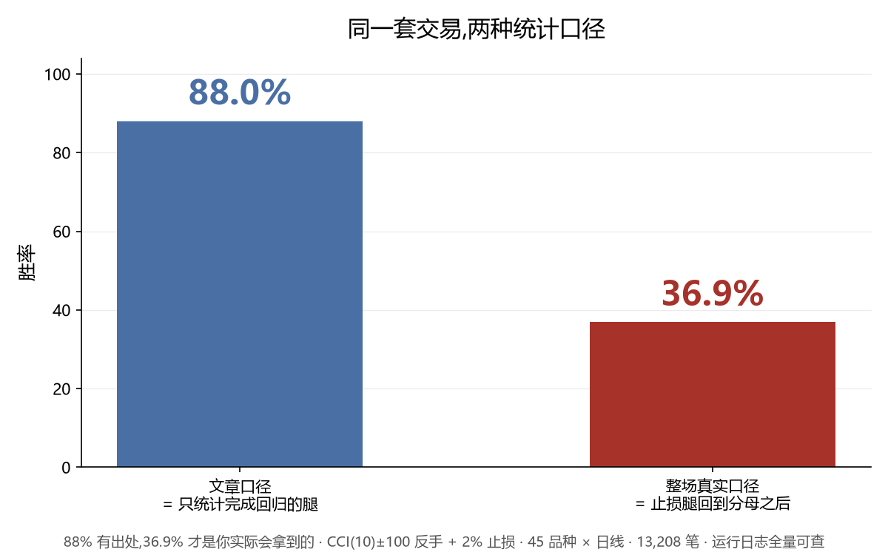

# 验尸报告 · CCI 均值回归(期货卷)· 十八格零存活

> 案卷 CCI-20261028-R(复跑版) · 公开样例 · 可转发 · **全部数字出自运行日志,[logs/](logs/) 全量可查**
> 本卷为按冻结规格 v2 的复跑(2026-11-05)。v1(2026-10-28)经证据链审计发现运行现场缺失,已作废;
> 复跑对 v1 公开数字构成独立证实:判决结构逐格复现,对照见文末。

## 委托命题

一篇流传较广的均线偏离度想法:CCI(10) 上穿 −100 买入、下穿 +100 卖出、反手制,
配 2% 固定止损,宣称胜率 88%、"参数经过验证"。

按预注册流程,在 45 个商品期货主力连续、六个周期上独立复核:日线为 2016-01 → 2026-11
共 11 个自然年;日内周期按各自实际数据窗(30m/60m 约 5.2 年、15m/10m/5m 约 2.8 年,
逐品种首末根清单见[运行日志](logs/_cci_all_20261105.txt))。
**十八个格子(六周期 × 三样本域),零存活。**

## 主表读数(全域档,成本 base = 手续费 + 2 跳/边)

| 周期 | 笔数 | 换手/年/品种 | 均持根 | 0成本毛利 | 净利 | 均/笔 | t | 随机超额/笔 | 判 |
|---|---|---|---|---|---|---|---|---|---|
| 日线 | 13,208 | 27.3 | 5.1 | −1,279,921 | −2,471,186 | −187 | −4.15 | −137 | 不过 |
| 60 分钟 | 22,809 | 146.6 | 10.1 | −852,585 | −2,995,736 | −131 | −5.36 | −28 | 不过 |
| 30 分钟 | 36,140 | 232.1 | 11.3 | −1,372,371 | −4,774,578 | −132 | −8.14 | −31 | 不过 |
| 15 分钟 | 29,492 | 416.0 | 12.8 | −855,332 | −3,565,815 | −121 | −7.17 | −24 | 不过 |
| 10 分钟 | 73,781 | 669.6 | 13.5 | −172,127 | −7,266,772 | −99 | −12.89 | −0 | 不过 |
| 5 分钟 | 131,775 | 1,195.9 | 14.0 | −267,244 | −12,974,186 | −98 | −22.47 | +1 | 不过 |

- 17 / 18 个格子**把成本设成零毛利仍为负**;唯一毛利为正的格子(60 分钟剔指纹域
  +122,005)扣完成本净亏 140.1 万(t −5.50)。
- 日线 2016–2026 共 **11 个自然年,无一为正**(分年从 −6.3 万到 −52.2 万);
  45 个品种里盈利的只占 17.8%。
- **随机入场对照跑赢策略**(日线随机超额 −137 元/笔):信号比乱买还差;
  5m/10m 档随机超额 ±1 元 ≈ 纯噪声区——两个分辨率下信号都不含信息。

## 死因解剖:88% 藏在哪

把日线 13,208 笔按出场原因拆堆(另有口径说明见下):

| 腿 | 笔数 | 毛值合计(0成本) | 净值合计(扣base) | 净值均值 | 净值胜率 |
|---|---|---|---|---|---|
| 反手出场腿 · 拿到回归完成 | 5,699 | **+1,446.3 万** | +1,396.6 万 | +2,451 元 | 85.4% |
| 止损腿 · 回归走完前被砍 | 7,485(56.7%) | **−1,577.9 万** | −1,647.1 万 | −2,201 元 | 0% |
| 期末强平 | 24 | +3.6 万 | +3.4 万 | +1,417 元 | 45.8% |

**口径说明**:毛值合计 = 0 成本口径;净值均值 = 扣 base 成本(手续费 + 2 跳/边,
日线约 90 元/笔)后每笔净值——所以均值 × 笔数 ≠ 合计,不是算错。三堆毛值相加
= 全案卷 0 成本毛利(−128.0 万),分解闭合,逐笔可查 [logs/](logs/)。

均值回归的"回合"真的存在——活到回归完成的那批腿确实赚,净值胜率 85.4% 与文章的
88% 几乎吻合。但你无法提前知道哪一笔能活到那天:2% 固定止损相当于约 1.2 倍日 σ,
把 56.7% 的腿在回归走完之前整段砍掉,砍掉的损失吃光全部回合利润还倒贴。

**整场胜率(止损腿回到分母后)= 36.9%,PF 0.855**(净值口径;0 成本口径
37.7% / 0.92——口径不同,判决相同)。88% 有出处,36.9% 才是你实际会拿到的。

## 参数消融(跑前冻结,全部跑完)

- **止损敏感性(日线,0 成本)**:无止损 −113.0 万 / 1% −110.8 万 / 2% −128.0 万 /
  3% −175.0 万。任何比例都救不回毛负——**没有参数复活路径**。
- 周期与带宽邻域(N 14/20:−80.3 万 / −64.1 万;带宽 ±200:毛 +3.2 万 / 净 −19.6 万,
  t −0.49 不过任何门):参数不背锅,死因在信号本身。
- 方向镜像:日线转正(毛 +243.2 万 / 净 +173.1 万,t +2.22),但 30 分钟转负
  (净 −156.1 万,t −2.54)——按事先冻结的反钓条款(翻案须全部变体同向过门),
  不构成翻案。它只说明一件事:这篇文章连自己的方向都讲反了。

## 逐笔抽查

最差单笔复核过账:sc 多头 2026-04-08 入场 705.1,次日跳空开盘 611.0 触发止损,
按开盘劣价成交,单笔 **−94,540 元**(价差 −94,100 + base 成本 440 = 滑点 400 +
手续费 40)。该笔在 60 分钟带逐笔记录里逐位可查
([logs/_cci_trades_60min_20261105.csv](logs/_cci_trades_60min_20261105.csv))。
pnl = 价差 × 乘数 × 手数,对拍一致。记账无误,亏损是真实的。

## 判决

**18 / 18 归档判死。** 死因不是手续费——17/18 格零成本毛利为负;死因是
固定比例止损与均值回归的时间结构互斥:它把超过一半的腿在回归完成前送走。
你拿到的不是 88%,是 36.9%。

## 运行现场与复跑声明

v1(2026-10-28)公开后经证据链审计:运行现场(脚本/逐笔/控制台输出)缺失。
按本店规矩,无现场的数字不得引用——规格补全为 v2(分周期数据源与逐品种起点、
口径定义、出场原因编码全部写死,[PREREG](logs/PREREG_CCI_v2_20261105.md)),
2026-11-05 复跑,**现场全量落盘 [logs/](logs/)**(六周期逐笔 CSV、控制台全量输出、
门禁汇总表)。

**v1 ↔ R1 对照**(同规格、数据更新至 11 月初后的两次独立运行):判决结构逐格复现
——18/18 判死、唯一毛利为正格同为 60 分钟剔指纹域、日线 11 年全负、方向镜像日线
转正而 30 分钟转负不翻案;逐格数字差 ±1~8%(数据更新所致);关键锚点逐位复现:
期末强平 24 笔、sc 单笔 −94,540 元、5m 档 0 成本毛利 −26.7 万、15 分钟档 t = −7.17。
验尸报告自己也要经得起验尸。

*本报告为历史数据回测复核,不构成投资建议,不代客理财,不承诺收益。*
