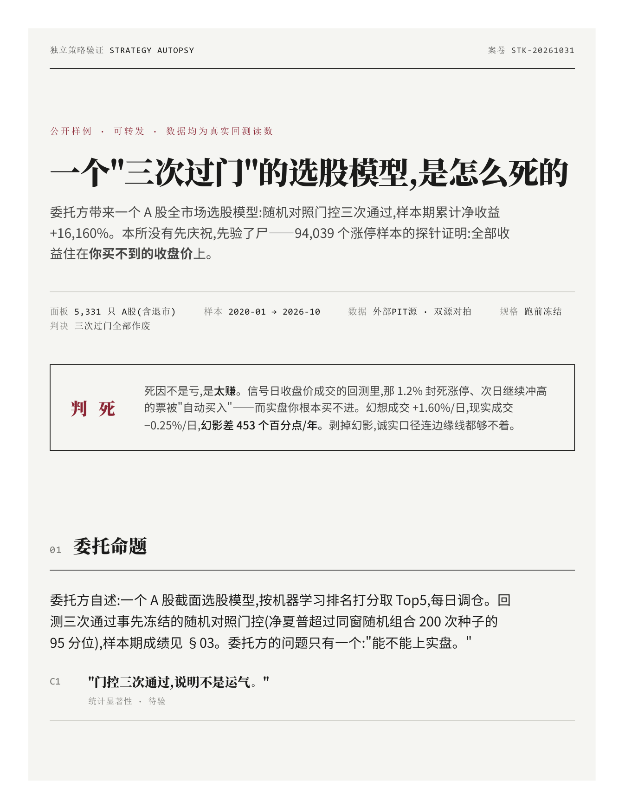

# 验尸报告 · 一个"三次过门"的 A 股选股模型,是怎么死的

> 案卷 STK-20261031 · 公开样例 · 可转发 · 全部数字出自真实运行日志
> 本页为转写摘要;完整报告通过 [README](../../README.md) 文末联系方式获取。

## 委托命题

A 股全市场选股模型(ML 排名 Top5、每日调仓),回测**三次通过冻结的随机对照
门控**,样本期累计净收益 **+16,160%**。委托方问:"能不能上实盘。"

本所没有先庆祝,先验了尸。

## 三次过门的成绩单(委托方口径,全部属实)

| 配置 | 随机对照门控* | 样本期净收益 | 状态 |
|---|---|---|---|
| hold5 · expand | 99.3%(5/6 折过 95 线) | +170% | 过门 → 作废 |
| hold5 · rolling | 100%(5/6 折过 95 线) | **+16,160%** | 过门 → 后文作废 |
| hold10 · expand | 76.9%(1/6 折过 95 线) | — | 不过 |
| hold10 · rolling | 96.3%(3/6 折过 95 线) | +982% | 过门 → 作废 |

\* 门控值 = pooled pct 中位:策略 Top5 净夏普超过同窗随机对照(每配置 200 次随机)
第 95 百分位的比例,取折间中位;括号内 = 6 折中该比例 ≥ 95% 的折数。
过门 = pct 中位 ≥ 0.95 且毛超额 > 0。数据 = 全市场 5,331 只(含 2020 年来退市股)。

门控本身没坏——坏的是,门控**管不住执行语义**:三次过门,过的是同一个幻觉。

## 第 0 考场:全部收益住在买不到的收盘价上

把 94,039 个收盘涨停非一字样本全部调出做探针:

| 口径 | 日均收益 | 年化 |
|---|---|---|
| A · 幻想成交(信号日收盘买入,close-to-close) | **+1.60%** | +391% ~ +501%/年 |
| B · 现实成交(次日开盘买入,open-to-close,涨停禁入) | **−0.25%** | 7 年全负(−33% ~ −120%) |

**幻影差 = 453 个百分点/年。**

### 验尸直证:模型最爱的票,正是你买不进的票

把 hold5 rolling 的 5,190 笔入选记录全部调出:

- 入选票**信号日收盘涨停率 18.63%**,全市场基率 1.30% → **14.3 倍富集**
- 入选票信号日平均已涨 **+3.00%**,同期市场中位 0.00%

回测里那 1.2% 封死涨停、次日继续冲高的票被"自动买进"——而实盘你根本买不进。
涨停不是模型的 alpha 来源,是模型的**选票指纹**:它专挑已经涨到你追不上的票,
然后把那段的涨幅记到自己账上。

## 判决

**三次过门全部作废。** 死因不是亏,是太赚。

1. A 股回测的**第一刀永远是成交价语义**。收盘价成交 = 把涨停日连本带利白送给
   策略;这一刀不审,后面所有统计都是装修。
2. 读数越漂亮,第一反应是找指纹。14.3 倍的涨停富集不是运气,是结构性的
   "买入不可能成交的票"。
3. 随机对照门控是真东西,但它必须**架在第 0 考场之上**——语义不对,门控
   通过多少次都只是在精确地测量一个幻觉。

*本报告为历史数据回测复核,不构成投资建议,不代客理财,不承诺收益。*
