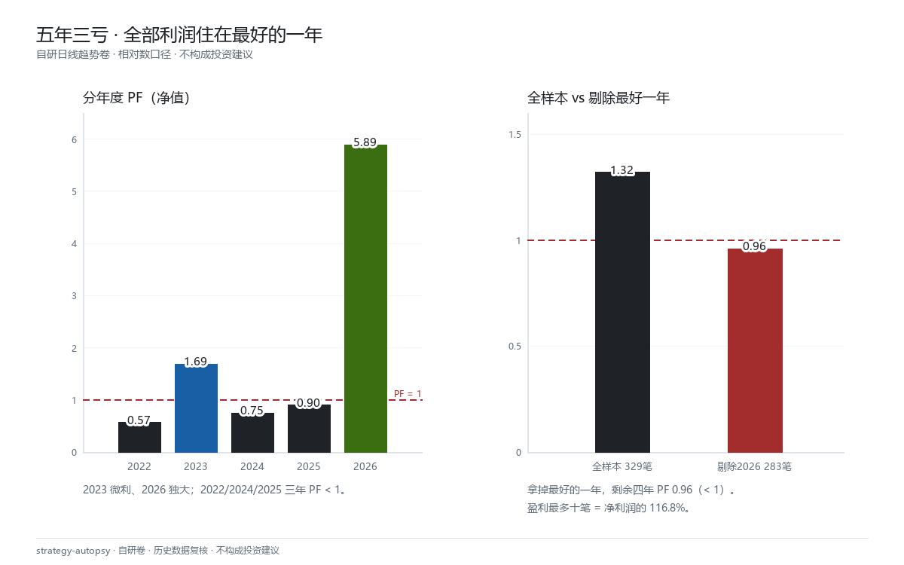

# 验尸报告 · 自研日线趋势卷 · PF 1.32 仍不部署

> 案卷 SELF-DT-20261010 · 公开样例 · 可转发 · **数字出自 2026-10-10 内部评审原始记录，本页为公开转写（2026-11-08）**
> 自研存货，不是客户委托。参数数值按脱敏契约隐去；相对数（PF / 笔数 / 百分比 / 年化）全部保留。
> 本卷不附逐笔日志：评审时点早于本店「现场全量落盘」规矩，**不补跑、不编现场**。判决不依赖缺失项。

## 委托命题

不是别人送来的想法，是我自己的日线趋势存货：均线状态式入场 + ATR 止损，
信号收盘确认、次日开盘成交（无前视），可过夜，按风险预算给手数。
主指标**全部达标**——按常规流程，到这里就该进挂载评审。

本卷回答一个问题：**PF 达标、稳健性三检全过，为什么仍然不部署。**

## 规格公开版（参数隐去）

- 样本：47 个商品期货品种 × 1138 个交易日（2022-01-05 ~ 2026-09-14），主力连续带复权
- 成本：手续费 1.5bp + 2 tick 滑点（按成交记录校准）；按风险预算给手数，非固定 1 手
- 执行：信号 t 日收盘计算，t+1 日开盘成交；止损盘中触发，跳空按劣价
- 周期：日线。同规则往更短周期切是消融项，不是主读
- 隐去：均线周期对、ATR 倍数、风险预算百分比、同时持仓上限、品种名单

## 主成绩单（全部属实）

| 项目 | 结果 | 门槛 | 判定 |
|---|---|---|---|
| 净 PF | **1.32** | > 1 | PASS |
| 毛 PF | 1.41 | — | 有资格进下一轮 |
| 胜率 | 39.2%（329 笔） | — | 趋势型常态 |
| 最大回撤 | 8.20% | — | 仅披露 |
| Top3 集中度 | 21.6% | < 60% | PASS |
| 符号一致性 | 65.2% | ≥ 60% | PASS |
| 成本 3× 滑点 | PF 1.30 | > 1 | PASS |
| Leave-One-Out | PF 1.23 ~ 1.28 | > 1 | PASS |

参数曲面是**平台不是尖峰**：快慢比约 1:3 的那一行整行站得住，不是孤立格。
止损放宽是有机理的真改善，不是拟合——止损笔数从约一半降到约一成，
更多仓位活到信号反转出场（信号反转笔数 88 → 300）。这一项我认。

按年拆开之前，这就是一份能挂载的报告。

## 三道否决线

### 第一道 · 年度结构

| 年 | 笔数 | PF | NAV |
|---|---:|---:|---:|
| 2022 | 55 | 0.57 | −2.41% |
| 2023 | 72 | 1.69 | +3.85% |
| 2024 | 65 | 0.75 | −0.65% |
| 2025 | 91 | 0.90 | −1.61% |
| **2026** | 46 | **5.89** | **+11.99%** |

**五年里三年为负。剔除 2026：283 笔、PF 0.96、−1.48%。**

不是参数不好，是它只在一种行情制度里成立。IS 期（2022–2024）几乎所有参数 PF < 1，
OOS（2025–2026）反而好——参数选不出来，是制度决定一切。

### 第二道 · 大单依赖

盈利最多的 10 笔合计 = 净利润的 **116.8%**。去掉这 10 笔（占 329 笔的 3%），其余全是负的。

这种结构无法按风险预算放大仓位。放大等于把组合押在几段行情上。

仓位放大实测：风险预算翻倍，年化几乎不涨，回撤翻约 4 倍。**这个期望收益撑不起大仓位。**

### 第三道 · 周期迁移

同品种池（34）、同窗口（2025-08-13 ~ 2026-09-29），同一套规则换周期：

| 周期 | 净 PF | 毛 PF | 成本/净利润 | 单笔可捕捉片段（相对） |
|---|---:|---:|---:|---:|
| 日线 | 2.61 | 2.78 | 5.3% | 1.00 |
| 60 分钟 | 1.48 | 1.67 | 26.9% | 0.79 |
| 30 分钟 | 1.04 | 1.21 | 417.5% | 0.34 |
| 15 分钟 | 0.93 | 1.15 | −285.9% | 0.21 |

毛 PF 同步单调下降——退化不只是成本，**信号本身在短周期也变差**。
机制：趋势幅度给定，持仓越短单笔能吃的片段越小，而每笔滑点固定、与持仓时长无关。
该短窗口日线读数远好于全窗口（PF 2.61 vs 1.32），因为 2025-08 之后正是趋势大年。
再次印证：行情制度决定一切。

数据缺陷说明：15/30/60 分钟仅有日盘、无夜盘，结果偏乐观，不影响「周期越短越差」的方向。

## 反方意见与翻案路径（逐条否决）

1. **「放宽参数再找一组」**——参数曲面已扫过，某处 PF 1.40 是孤立尖峰（左邻 1.22、右邻 1.01），按「尖峰即噪音」不采信。
2. **「加吊灯移动止损让利润奔跑」**——扫描显示不加吊灯整体最好，加吊灯 PF 反降。与直觉相反，数据如此。
3. **「与日内策略组合分散」**——低相关有相当部分来自「日内 vs 过夜」的周期差异，且重叠样本太短、窗口是趋势大年异常值。可作研究备注，**不构成挂载理由**。

## 六考场对表

| 考场 | 读数 | 判 |
|---|---|---|
| 1 毛信号 | 毛 PF 1.41 | 过（入场券，不是毕业证） |
| 2 净利 t | 未出 t 值 | 不判，不补 |
| 3 IS-OOS / 年度结构 | 5 年 3 亏；剔最好年 PF 0.96 | **死** |
| 4 Top 集中度 | Top10 = 116.8% | **死** |
| 5 随机超额 | 未跑 | N/A，判决不依赖它 |
| 6 账户层 | 仓位放大崩 | 仅披露，确认不可放大 |

本卷死在**结构**，不死于毛负（对比 CCI 卷），也不死于成交语义（对比 STK 卷）。
三种死法不同，尺子是同一把。

## 判决

**NOT DEPLOYED。不占实盘样本期。代码与规格留档，参数不公开。**

PF 达标 ≠ 可上实盘。它捕捉的是趋势 β：震荡市持续失血，靠一个大年一次赚回。
满足「PF > 1」，不满足「稳定赚钱」。

### 复核条件（满足全部才重开）

1. 样本覆盖至少一个完整震荡市，且剔除最好年份后 PF > 1.10；
2. Top10 盈利单占净利 < 60%；
3. 在独立扩展窗口复现，且规格事先冻结；
4. 若引入组合配置，相关性结论需 ≥ 120 个重叠交易日。

## 运行现场声明

2026-10-10 评审早于本店「逐笔 CSV + 控制台全量落盘」规矩。
本卷**不补造日志**。CCI 卷 v1 因现场缺失作废复跑的教训，用在这里就是：
没现场的自研卷不装作有现场。需要看带现场的卷，去
[期货卷 · CCI](../01_futures_cci_mean_reversion/report.md)。

*本报告为历史数据回测复核，不构成投资建议，不代客理财，不承诺收益，不碰账户。*
