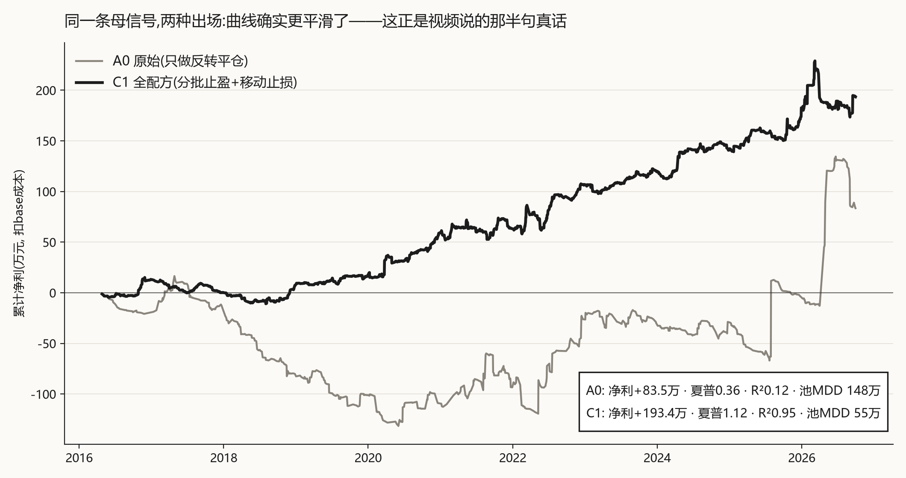
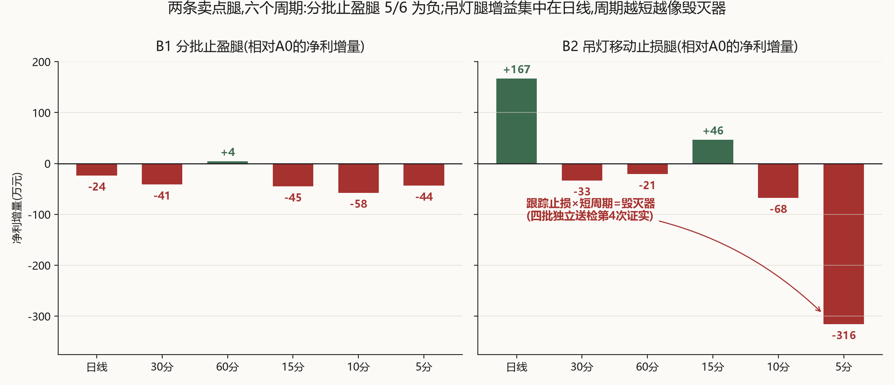
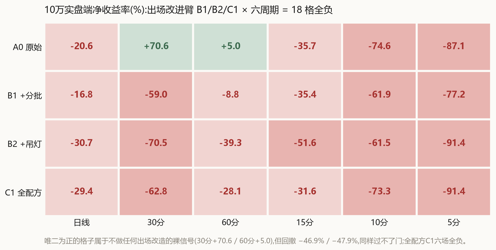

# 验尸报告 · 分批止盈+移动止损(期货卷)· 机制真,结论伪

> 案卷 TPT-20261002 · 公开样例 · 可转发 · **全部数字出自运行日志,[logs/](logs/) 全量可查**
> 判决后第 8 天做过一次回合级独立重算(资金阶梯重放),判决结构逐位复现,见文末。

## 委托命题

一篇流传较广的出场规则视频教程:给任意趋势/波段策略叠加 **分批止盈**(盈利达 ATR 阈值先平
1/2)+ **移动止损**(剩余仓位吊灯式 ATR 跟踪),宣称——

> 收益略低 / 回撤更低 / 盈亏比下降 / 胜率上升 / 夏普可能更高 / 卡玛大概率更高,**资金曲线更平滑**。

按跑前冻结的规格,在商品期货主力连续、六个周期上独立复核。**先说公平性**:这次验尸没有用
视频自己的信号(它没给),而是垫在本厂唯一已证日线毛正期望的裸形态上——双均线突破,
11 年 10 正、0 成本毛利 +121 万。**让出场规则在最健康的母体上接受检验**,它要是好习惯,
在这里应该活下来。

## 结果一句话

**六个考场全灭;10 万实盘端,出场规则的三条臂(分批/移动/全配方)× 六周期 = 18 格,无一为正。**
但曲线确实更平滑了——视频那半句真话,我们逐格复现了。问题在另一半。

## 主表读数(六考场门判据,C1 全配方)

| 周期 | G1 IS | G2 OOS | G3 夏普/MDD | G4 4tick | G5 品种≥40% | 死刑线 0成本毛利 | 换手/年/品种 | 判 |
|---|---|---|---|---|---|---|---|---|
| 日线 | √ +142.6万 | √ +50.8万 | × 1.12/−103.6% | √ +158.2万 | √ 41% | √ +234.6万 | 6.9, 成本吃18% | 不过(G3) |
| 30分 | × −20.0万 | √ +48.1万 | × 0.20/−473% | × −50.9万 | × 19% | √ +122.4万 | 34.8, 77% | 不过 |
| 60分 | √ +12.6万 | × −9.7万 | × 0.03/−188% | × −42.5万 | × 29% | √ +56.9万 | 19.9, 95% | 不过 |
| 15分 | × −24.3万 | √ +57.8万 | × 0.36/−275% | × −40.7万 | × 17% | √ +123.0万 | 63.8, 73% | 不过 |
| 10分 | × −50.4万 | √ +92.8万 | × 0.30/−355% | × −179.4万 | × 28% | √ +304.5万 | 172, 86% | 不过 |
| 5分 | × −215.1万 | × −28.9万 | × −1.65/−2342% | × −663.8万 | × 7% | √ +251.5万 | **322, 197%×不过** | 不过 |

注意最后一列的分工:**死刑线(0 成本毛利)六场全过**——母信号是好的,毛期望由它供给;
死因全在出场层与成本层。5 分钟档,成本吃掉毛利的 197%,即**还没开始赚,先亏两份钱**。

## 死因解剖

### 死因一:曲线真的平滑了,但平滑是拿右尾利润买的

视频的对比画面在日线**被精确复现**:日 PnL 标准差 6/6 全周期下降,曲线拟合 R² 0.12→0.95,
胜率 35.5%→58.6%,池层回撤金额 148 万→55 万。机制本身无条件成立。

但**分母掉得比分子快**。事件级核验(把切片行聚回入场回合)显示:短周期的"胜率上升"
全部是**一笔切两笔的记账效应**——分批止盈把一次出场拆成两行,胜率自然是切片口径的假象;
真回合胜率只有日线 +13.9pp 提升,5 分钟档反而从 32.2% 降到 30.6%。平滑的另一半来源是
"高频重进":事件数 859→2,372(2.8 倍),换手成本跟着乘上去。

### 死因二:两条卖点腿,一条减利,一条周期二象性

- **分批止盈腿:5/6 周期为负**。它把趋势利润提前落袋,尾仓并没有因此变好——是
  "减利换平滑"件,不是收益件。日线全配方(+193 万)比只加吊灯(+250 万)还少赚 57 万:
  分批不但自己减利,还把吊灯的增益吃掉了一半。
- **吊灯移动腿:周期二象性**。日线 +166.9 万(2017/2018 年的 −86 万窟窿被截住);
  5 分钟 **−315.6 万**(k×ATR14 在 5 分钟尺度=噪音绞肉机,止损腿 25,199 行/−1,021 万)。
  "跟踪止损×短周期=毁灭器"在此为第 4 次独立证实——它已经列为本厂送检黑名单观察项。

### 死因三:10 万实盘端,改进没有一格是正贡献

10 万账户口径(2% 风险 / 3×ATR 反推手数):**B1/B2/C1 三条出场臂 × 六周期 = 18 格全负**
(−8.8% ~ −91.4%)。唯二为正的格子属于不做任何出场改造的裸 A0(30 分 +70.6%、60 分 +5.0%),
但回撤 −46.9% / −47.9%,同样过不了门。更反直觉的是日线:吊灯在池层(2 手)大赚 +166.9 万,
在 10 万端反而 −30.7%,比裸信号还差——信号供给与保证金池严重失配,拒开 1,949 次,
**"能站进的不赚钱"**第三次复现。

### 死因四(彩蛋):连"验尸工具"本身也被分批止盈骗过一次

判决后第 8 天的独立重算中,首轮行级统计曾把这条腿误报为全台账唯一正臂(t=9.49、中位
+507)——原因正是**分批止盈把一笔切成两行**,制造了伪 t 与伪中位。改为回合级聚合后
t=2.56、中位 −150.9 元/手。同一个坑,先骗了原视频的胜率,又差点骗了验尸报告自己。

## 备件入库(验尸不是只判死)

唯一全维度改善对象是**日线、只加吊灯、k 取紧侧 2**:把裸双均线突破族从夏普 0.36/+83.5 万
提到 **1.04/+250.4 万**,池层回撤金额 148 万→62 万——历批第一次把吊灯跟踪**证真为增益件**
(此前三个批次同族全判伪)。条件严格:只在日尺度 + 母信号本身毛正 + k 紧侧。
换手 6.9 笔/年/品种,成本吃掉毛利的 18%,是全表唯一过得成本关的组合。

判决后第 8 天的回合级重算对它做了资金阶梯:3 万档 −11,711 元 → 10 万档 −59,583 →
**50 万档 +947,457 元(年化 10.7%、回撤 −22.1%、事件级 PF 1.29)**,80/80 回合入场价落在
当日合法价区间内。坏消息一起给:全池 85% 的净利集中在 sc/au/ag/cu 四个高保证金品种,
**3 万装得下的 21 个品种只贡献全池净利的 3%**;回合中位 −150.9 元/手、Top5 回合占净利 48.2%,
是右尾型,不是常态型。**它死在钱上,不是死在信号上——但对 10 万本金,依旧不可交易。**

## 判决

**六考场全灭归档;10 万端出场改进臂 18 格零存活。**判决词只有一句:

> **机制真,结论伪。**降方差与抬胜率(切片口径)无条件成立,但平滑是拿右尾利润买的,
> 分母掉得比分子快;"日尺度现象"被当成了"普适规律"卖给你——而把它搬到你实际在交易的
> 周期上,它是毁灭器。

## 运行现场

- 规格冻结:[prereg.md](prereg.md)(v1.1,跑批前)· 完整原文 [logs/PREREG_TPT_v1.1_20261002.md](logs/PREREG_TPT_v1.1_20261002.md)
- 控制台全量输出(网格、四臂、卖点判定表、10 万端逐格):[logs/_tpt_run_console_20261002.txt](logs/_tpt_run_console_20261002.txt)
- 逐笔明细(可复算事件级):[logs/_tpt_trades_daily_C1_20261002.csv](logs/_tpt_trades_daily_C1_20261002.csv) ·
  [logs/_tpt_trades_daily_A0_20261002.csv](logs/_tpt_trades_daily_A0_20261002.csv)
- 判决后第 8 天资金阶梯重放:[logs/_tpt_capital_ladder_20261010.txt](logs/_tpt_capital_ladder_20261010.txt)
- 数据窗:日线 2016-01→2026-10(11 个自然年);30m/60m 有效窗≈3.5 年;15m 多数 2024-12 起;
  10m/5m 2024-01 起(分合约主力拼接+比例后复权)。短周期的年化分母如实声明。

*本报告为历史数据回测复核,不构成投资建议,不代客理财,不承诺收益。*
